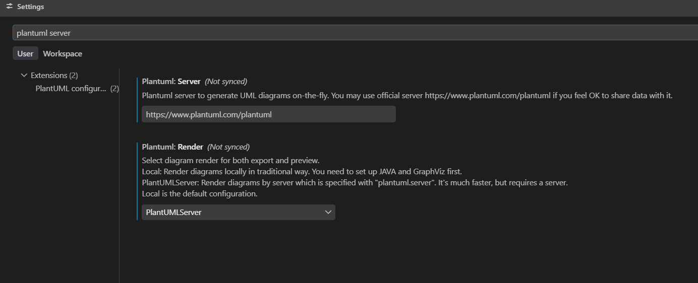
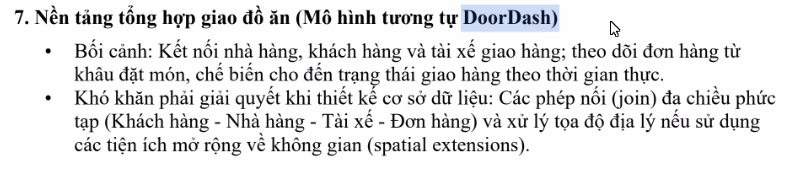
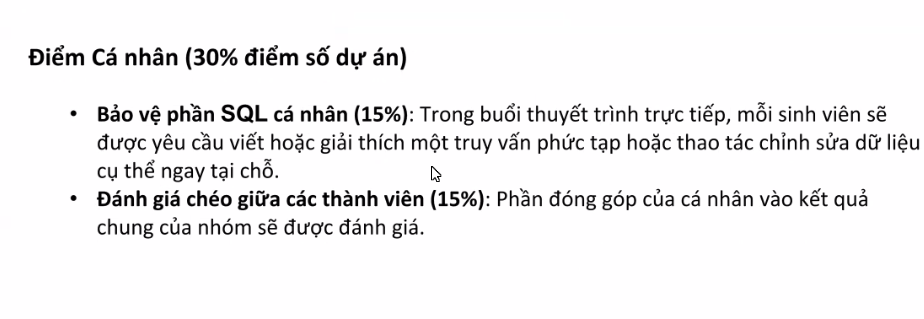

# CƠ SỞ DỮ LIỆU

## Thành viên nhóm G7:
- Nguyễn Đắc Quỳnh Loan
- Dào Bá Khả

#### 1. Tài liệu học tập
[INT1313_TX_DB-N07](https://drive.google.com/drive/folders/1PABLZ7oXI8rx9dFa32HzLg8N__WMxwBM)
- 
#### 1. Tool sử dụng
- Source Control : Github
- DBMS : Postgres + PostGIS (extension)
- App: Visual Studio Code
- Extension : [PlantUML](https://marketplace.visualstudio.com/items?itemName=jebbs.plantuml)
    - Lý do chọn : PlantUML nhẹ và dễ triển khai trên VSC, tiết kiệm thời gian vẽ ERD
    - Cấu hình :
    Mở Settings trong VS Code:
        1. Nhấn `Ctrl + ,` (Window)  hoặc `Cmd + ,` (macOS).
        2. Tìm kiếm từ khóa: plantuml server.
        3. Cấu hình 2 mục sau:
            - Plantuml: Render: Đổi từ Local sang PlantUMLServer.
            - Plantuml: Server: Nhập địa chỉ server chính thức:
            `https://www.plantuml.com/plantuml` như hình
            -
            
    - Hướng dẫn sử dụng :
        - Tạo file có định dạng `.plantuml`
        - Tổ hợp phím `Alt + D` hoặc click chuột phải và chọn Preview current page

#### 2. Bài tập
#### 2.1. Bài tập cá nhân
- Chương 3
- Chương 4
#### 2.2. Bài tập nhóm
- Thiết kế hệ thống giao đồ ăn

- Theo thang diểm

* Bối cảnh :
    - Kết nối nhà hàng, khách hàng và tài xế giao hàng;
    - theo dõi đôn hàng từ khâu đặt món, chế biến cho đến trạng thái giao hàng theo thời gian thực
* Khó khăn phải giải quyết khi thiết kế CSDL :
Các phép kết nối (join) đa chiều phức tạp (Khách hàng - Nhà hàng -Tài Xế - Đơn hàng) và xử lý tọa độ địa lý nếu sử dụng tiên ích mở rộng về không gian (spatial extensions)

Phân tích
- Xác định các entity, bao gồm
    Nhà hàng
    Tài xế
    Khách hàng
    Đơn hàng
    Món ăn
- xác đinh mqh
    1 Tài xế - n  đơn hàng
    1 nhà hàng - n đơn hàng
    1 khách hành - n đơn hàng
    1 đơn hàng - n món
- thuộc tính
    - Nhà hàng
        - tên
        - địa chỉ
        - start_time
        - end_time
        - limit_space
    - món ăn
        - order_id (FK)
        - name
        - note
        - quantity số lượng
        - is_ok_delivery : bool (0 : wait , 1 : taken)
        - price
    - đơn hàng
        - shipper_id (FK)
        - customer_id (FK)
        - restaurant_id (FK)
        - code
        - status : tinyint (0 : wait , 1 : delivery , 2 : done)
        - total_price
        - range
        - create_at
        - delete_at
    - tài xế
        - name
        - car_info
        - order_ id (FK)
        - start_at
        - end_at
        - from_place
        - to_place
        - current_place (mục 2)
    - khách hàng
        - name
        - order_id
        - payment tinyint (0 : cash ; 1 : debit ; 2 : credit )
        - address

| STT   | Tên thực thể (Entity) | Tên bảng (Table) | Mô tả ngắn gọn
| :---: | :---                  | :---             | :---
| **1** | Khách hàng            | `customers`      | Lưu thông tin cá nhân của người mua hàng
| **2** | Nhà hàng              | `restaurants`    | Lưu thông tin quán ăn, cửa hàng ẩm thực.
| **3** | Tài xế                | `shippers`       | Lưu thông tin shipper nhận và giao đơn.
| **4** | Món ăn                | `dishes`         | Lưu danh sách món ăn được chọn , có thể hiểu là order item.
| **5** | Đơn hàng              | `orders`         | Lưu thông tin chung của đơn hàng.

---

## 🔗 Sơ đồ Quan hệ (Relationships)

* **Khách hàng (1) $\leftrightarrow$ (n) Đơn hàng**: Một khách hàng có thể đặt nhiều đơn hàng.
* **Nhà hàng (1) $\leftrightarrow$ (n) Đơn hàng**: Một nhà hàng nhận nhiều đơn hàng.
* **Tài xế (1) $\leftrightarrow$ (n) Đơn hàng**: Một tài xế có thể giao nhiều đơn hàng (tuỳ thời điểm).
* **Nhà hàng (1) $\leftrightarrow$ (n) Món ăn**: Một nhà hàng sở hữu một thực đơn gồm nhiều món.
* **Đơn hàng (1) $\leftrightarrow$ (n) Chi tiết đơn hàng $\leftrightarrow$ (1) Món ăn**: Quan hệ Nhiều - Nhiều giữa Đơn hàng và Món ăn thông qua bảng trung gian `order_items`.

2. Tìm hiểu
PostGIS
    - Geography : lưu trữ vị trí -> tracking location của shipper
    - Geometry : tìm đường, phân phối giao hàng -> tìm quán gần (optional)

3. Tham khảo Link
- [PostGIS Geometry vs Geography: A Practical Decision Guide](https://medium.com/@philmcc/postgis-geometry-vs-geography-a-practical-decision-guide-9d8d2cf1ea40)